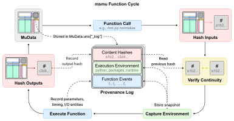
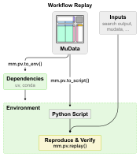

# Provenance

`msmu` records supported processing calls in `mdata.uns["_log"]`. The history stays
with the `MuData` object and its `.h5mu` file, so processing steps can be inspected,
exported, and replayed from the original inputs.

See the [Verification tutorial](../tutorials/verification.ipynb) for event inspection,
replay, script export, and environment setup examples.

{ width="100%" }

## Recorded information

Each completed call records:

- The function and its parameters, including defaults.
- Input and output references and content hashes.
- Execution times and the Python/package environment.

Before executing a function that records provenance, `msmu` compares the input
`MuData` hash with the output hash from the previous recorded step. A mismatch
produces an `msmu` warning that the data have changed outside the recorded workflow;
the function still runs.

## Content hashes

The current hashing policy, `msmu-v2`, uses SHA-256 and retains up to
**12 significant digits** of floating-point values when computing hashes.
It covers all `MuData` content except the provenance log.

Hashing is enabled by default, but during exploratory analysis or repeated parameter changes, you can turn hashing
off to skip input/output hash calculations. This can reduce runtime and temporary
memory use, especially for large data objects. Function calls, parameters,
execution times, and environments are still recorded, but steps recorded without
hashes cannot be verified by replay.

```python
import msmu as mm

# Temporarily disable hashing for a separate result.
with mm.pv.options(hashing=False):
    unverified = mm.pp.scale_data(mdata, modality="psm")

# Disable hashing for subsequent processing calls.
mm.pv.set_options(hashing=False)
```

## Execution environment

Environment records include Python and installed package versions, OS and
architecture, available `msmu` source information, and numerical runtime settings.

The recorded package/source information is cached on the first recorded call in a
Python process. Restart Python to refresh this information after changing packages
or source code.

Numerical runtime settings are checked at the start of each recorded function call.
New configurations are stored as separate environment records.

The recorded Python and package versions can later be exported with
[`mm.pv.to_env()`](../reference/pv/to_env.md) as `requirements.txt` or `environment.yml`.

## Function events

Each recorded call creates a function event linking the function and its parameters
to the execution environment and input/output references. Parent-event links connect
the event to the steps that produced its inputs, preserving data lineage across
branches and merges.

## Replay

{ width="360" }

The history stored in a `MuData` object connects the original inputs to the recorded
processing steps and their results. [`mm.pv.replay()`](../reference/pv/replay.md) uses
this history to rerun supported workflows with the recorded parameters. It verifies
input and output hashes at each step, allowing you to check whether the rerun
reproduces the recorded data states.

For a workflow that can be reviewed, shared, or adapted,
[`mm.pv.to_script()`](../reference/pv/to_script.md) generates an editable Python script
from the same history. The script contains the recorded processing calls and can
verify their results against the original hashes. It can also serve as a starting
point for changing inputs or analysis parameters.

To help prepare the software environment for reproduction,
[`mm.pv.to_env()`](../reference/pv/to_env.md) exports the recorded Python and package
versions as `requirements.txt` or `environment.yml`. These specifications can be used
alongside the script and original input data to set up and rerun the analysis.
