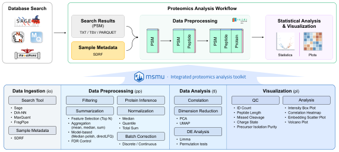

**Python toolkit for modular and traceable LC-MS/<u>MS</u> proteomics analysis based on <u>Mu</u>Data**

Start with [Installation](installation.md) and the runnable [Quick start](tutorials/quick_start.ipynb).
For development-only APIs, use the source checkout described in the installation guide.

## Overview

`msmu` is an open-source Python package for modular and traceable post-DB search preprocessing and statistical analysis of bottom-up proteomics data.

It supports modules for every step of end-to-end processing—from search output parsing through hierarchical summarization, normalization, batch correction, statistical analysis, and visualization—implemented with commonly used analytical and statistical methods. 

Central to `msmu` is the highly versatile and standardized `MuData` (and `AnnData`) as a unifying, provenance-aware data container for organizing and storing annotations and representations of multi-dimensional MS data and processing history.

This unique marriage between flexible processing pipeline and `MuData` empowers FAIR principle-aligned downstream analysis for biomarker discovery and systems biology.

## Key features

- **Flexible data ingestion** from Sage, DIA-NN, and other popular DB search tools
- **`MuData`/`AnnData`-compatible** object structure for organizing multi-level MS data
- **SDRF-native sample metadata**: attach a validated SDRF as the immutable source of truth and project it onto samples
- **Command provenance**: supported processing calls record arguments, execution times, environment versions, lineage, and optional content hashes in the container; console output and dimension summaries are not stored
- **Protein inference**: infer protein groups from peptide evidence using parsimony rule
- **Hierarchical summarization**: PSM/precursor → peptide → protein/PTM rollup (median, mean, sum, median polish, and DirectLFQ)
- **Normalization**: median centering, quantile normalization, etc.
- **Batch correction** for discrete and continuous variations
- **Built-in QC**: identification count, peptide length, charge, missed cleavage, intensity distribution, etc.
- **Statistical analysis**: differential expression (limma moderated-t by default, or a label-permutation test), dimensionality reduction
- **PTM data support** and stoichiometry adjustment with matched global dataset (if available)
- **Visualization**: PCA, UMAP, volcano plots, heatmaps, and QC metrics

## Supported DB search tools

| Tool | Supported inputs | Repository | Publication |
| --- | --- | --- | --- |
| [Sage](https://sage-docs.vercel.app) | DDA (label-free or TMT) | [lazear/sage](https://github.com/lazear/sage) | [Lazear (2023)](#ref-lazear-2023) |
| [DIA-NN](https://github.com/vdemichev/DiaNN) | DIA (label-free precursors) | [vdemichev/DiaNN](https://github.com/vdemichev/DiaNN) | [Demichev et al. (2020)](#ref-demichev-2020) |
| [MaxQuant](https://www.maxquant.org/) | DDA (label-free or TMT) | [JurgenCox/mqtools7](https://github.com/JurgenCox/mqtools7), partial | [Cox and Mann (2008)](#ref-cox-2008) |
| [FragPipe](https://fragpipe.nesvilab.org/) | DDA (label-free or TMT) | [Nesvilab/FragPipe](https://github.com/Nesvilab/FragPipe) | [Kong et al. (2017)](#ref-kong-2017) |
| [DelPi](https://github.com/bertis-informatics/delpi) | DIA (label-free precursors) | [bertis-informatics/delpi](https://github.com/bertis-informatics/delpi) | [Park et al. (2026)](#ref-park-2026), preprint |

Supported inputs describe the data that `msmu` can import from each tool. See [Data ingestion](how-it-works/data.md#data_ingestion_from_db_search_tools) for input files and reader options.

## License

BSD 3-Clause License. See `LICENSE` for details.

## Citation

If you use `msmu` in your research, please cite the following publication (preprint):

> Choi, H.-W., Lee, B., Kang, U.-B., and Huh, S. msmu: a Python toolkit for modular and traceable LC-MS proteomics data analysis based on MuData. *bioRxiv* 2026.01.07.698308 (2026). [https://doi.org/10.64898/2026.01.07.698308](https://doi.org/10.64898/2026.01.07.698308).

## References

> Lazear, M. R. Sage: an open-source tool for fast proteomics searching and quantification at scale. *Journal of Proteome Research* 22, 3652–3659 (2023). [https://doi.org/10.1021/acs.jproteome.3c00486](https://doi.org/10.1021/acs.jproteome.3c00486).

> Demichev, V., Messner, C. B., Vernardis, S. I., Lilley, K. S., and Ralser, M. DIA-NN: neural networks and interference correction enable deep proteome coverage in high throughput. *Nature Methods* 17, 41–44 (2020). [https://doi.org/10.1038/s41592-019-0638-x](https://doi.org/10.1038/s41592-019-0638-x).

> Cox, J. and Mann, M. MaxQuant enables high peptide identification rates, individualized p.p.b.-range mass accuracies and proteome-wide protein quantification. *Nature Biotechnology* 26, 1367–1372 (2008). [https://doi.org/10.1038/nbt.1511](https://doi.org/10.1038/nbt.1511).

> Kong, A. T., Leprevost, F. V., Avtonomov, D. M., Mellacheruvu, D., and Nesvizhskii, A. I. MSFragger: ultrafast and comprehensive peptide identification in mass spectrometry–based proteomics. *Nature Methods* 14, 513–520 (2017). [https://doi.org/10.1038/nmeth.4256](https://doi.org/10.1038/nmeth.4256).

> Park, J., Kim, K., Kang, U.-B., and Kim, S. DelPi learns generalizable peptide–signal correspondence for mass spectrometry-based proteomics. *bioRxiv* 2026.01.06.697814 (2026), preprint. [https://doi.org/10.64898/2026.01.06.697814](https://doi.org/10.64898/2026.01.06.697814).
